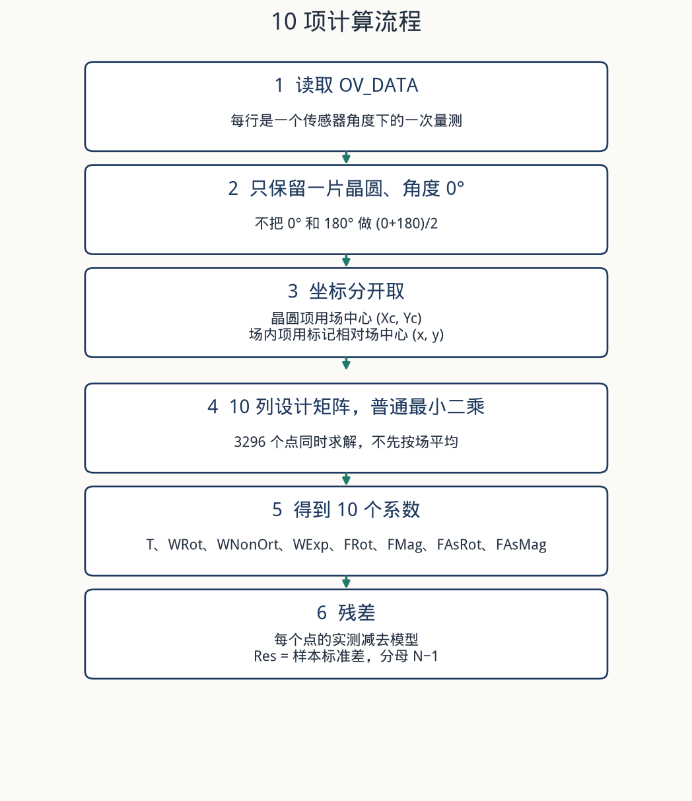
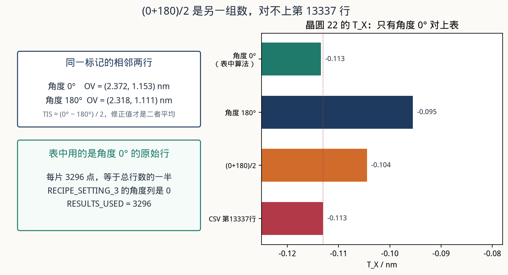
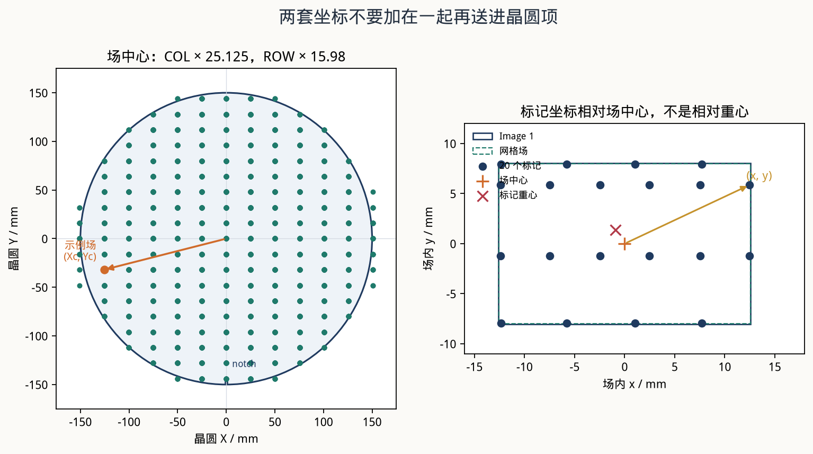
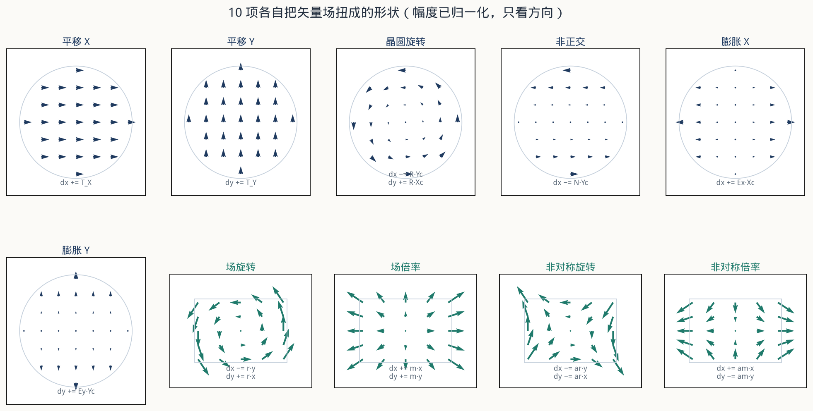
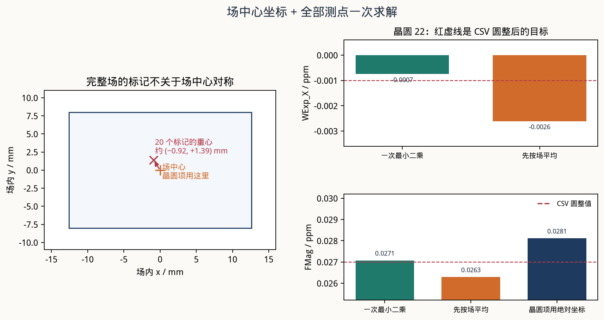
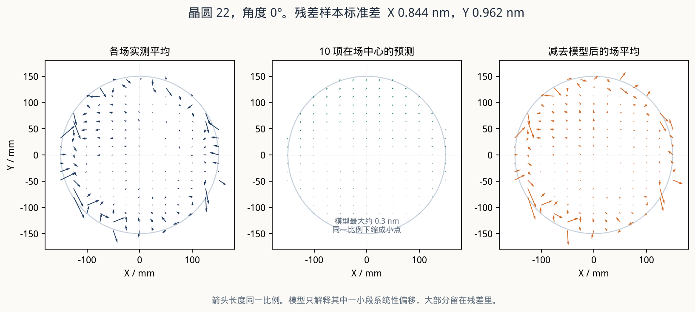
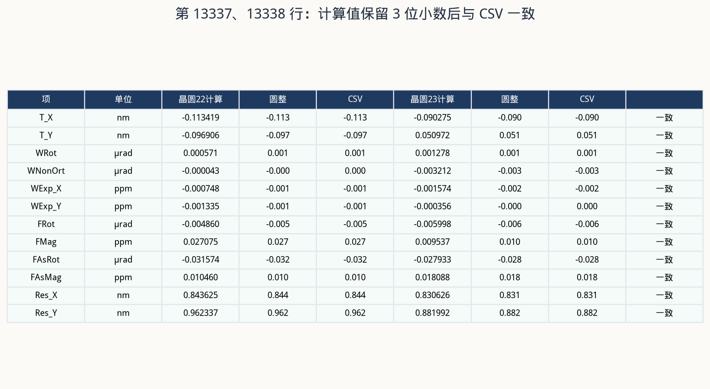

# Overlay 10 项算法

第 13337、13338 行是 YieldStar 对两片晶圆、传感器角度 0° 做的 `10par` 结果。按下面的算法计算，10 个系数和 `Res_X`、`Res_Y` 保留 3 位小数后与这两行一致。

这两行不是 TIS 修正值。`(0+180)/2` 会得到另一组数，对不上这张表。

实现在 `src/overlay_10par.py`。用这份量测文件复核：

```bash
python3 src/verify_10par.py
```

## 表上的两行是什么

它们位于 `[RECIPE_SETTING_3]`。该段的配方头是：

- `MEASUREMENT_OPTION = TIS`
- `SENSOR_TO_TARGET_ANGLE = 0`
- `PARAMETER_MODEL = 10par`
- `RESULTS_USED = 3296`

3296 是一片晶圆全部行数 6592 的一半，也就是只取了角度 0°。第 13337 行是 slot 22（`NFP01255.22`），第 13338 行是 slot 23（`NFP01255.23`）。

| 项 | 单位 | 晶圆 22 | 晶圆 23 |
|---|---|---:|---:|
| T_X | nm | -0.113 | -0.09 |
| T_Y | nm | -0.097 | 0.051 |
| WRot | µrad | 0.001 | 0.001 |
| WNonOrt | µrad | 0 | -0.003 |
| WExp_X | ppm | -0.001 | -0.002 |
| WExp_Y | ppm | -0.001 | 0 |
| FRot | µrad | -0.005 | -0.006 |
| FMag | ppm | 0.027 | 0.01 |
| FAsRot | µrad | -0.032 | -0.028 |
| FAsMag | ppm | 0.01 | 0.018 |
| Res_X | nm | 0.844 | 0.831 |
| Res_Y | nm | 0.962 | 0.882 |

文件里的小数会丢掉末尾的 0，所以 `-0.090` 写成 `-0.09`，`0.010` 写成 `0.01`。比较时先保留 3 位小数，再和表上的数比较。



## 不要先做 (0+180)/2

`[OV_DATA]` 里每个物理标记占相邻两行：一行 `SENSOR_TO_TARGET_ANGLE = 0`，一行 `180`。例如晶圆 22、场 `(-6, -3)`、标记 `(12.4725, 5.856)`：

- 0°：`(2.372, 1.153) nm`
- 180°：`(2.318, 1.111) nm`

TIS 是这两次之差的一半，TIS 修正后的套刻才是两次的平均。文件把两次都原样留下了，没有预先平均。

同一套最小二乘，只换输入，晶圆 22 的 `T_X` 是：

| 输入 | T_X / nm |
|---|---:|
| 角度 0° | -0.113 |
| 角度 180° | -0.095 |
| (0+180)/2 | -0.104 |
| 第 13337 行 | -0.113 |

只有角度 0° 与表一致。角度 180° 则与后面第 13369、13370 行一致，可以当作同一算法的另一次核对。



文件头里 `OV_SIGN_CONVENTION = Corrections`。拟合时直接使用表中的 `OV_X`、`OV_Y`，不要再取反。系数的正负就沿用这个约定。

## 坐标：晶圆项用场中心，场内项用标记相对位置

场中心由场号和网格间距得到，本文件网格偏移为 0：

```text
Xc = COL * 25.125 mm
Yc = ROW * 15.98 mm
```

这就是 `FIELDCENTER_X/Y`。标记的场内坐标是 `TARGETPOS_X/Y`，记为 `(x, y)`，原点在场中心，不是标记重心，也不是场的角点。

标记的晶圆绝对坐标是 `(Xc + x, Yc + y)`。10 项模型不把这个绝对坐标代进晶圆项。晶圆项只用 `(Xc, Yc)`，场内项只用 `(x, y)`。



右图是一个完整场的 20 个标记。它们的重心大约在 `(-0.92, +1.39) mm`，不在场中心。Image 1 比步进网格略大，个别标记会落在网格矩形外面、图像矩形里面。场中心仍然用网格中心，不要改到图像中心或标记重心上。

## 10 项公式

坐标单位 mm，套刻单位 nm。这时膨胀系数直接是 ppm，旋转和非正交直接是 µrad，因为 `1 ppm × 1 mm = 1 nm`，`1 µrad × 1 mm = 1 nm`。不要再乘 1000。

```text
dx = T_X
   + WExp_X * Xc
   - (WRot + WNonOrt) * Yc
   + (FMag + FAsMag) * x
   - (FRot + FAsRot) * y

dy = T_Y
   + WRot * Xc
   + WExp_Y * Yc
   + (FRot - FAsRot) * x
   + (FMag - FAsMag) * y
```

6 个晶圆项看整片晶圆，4 个场内项在每个场里重复同一形状。

| 项 | 只看这一项时的矢量 |
|---|---|
| T_X, T_Y | 全片同向平移 |
| WRot | 绕晶圆中心逆时针：`dx = -R·Yc`，`dy = R·Xc` |
| WNonOrt | 只有 X 分量，大小正比于 Y。X 轴是参考轴，Y 轴偏离直角 |
| WExp_X, WExp_Y | 沿 X 或 Y 随坐标拉开 |
| FRot | 每个场内逆时针转 |
| FMag | 每个场以场中心为心、X 和 Y 同比例放大 |
| FAsRot | 场内一正一负的旋转，形成剪切 |
| FAsMag | X 放大时 Y 缩小 |



场内 4 项和原始线性系数的关系是：

```text
dx 里 x 的系数 = FMag + FAsMag
dy 里 y 的系数 = FMag - FAsMag
dx 里 y 的系数 = -(FRot + FAsRot)
dy 里 x 的系数 = FRot - FAsRot
```

所以

```text
FMag   = (ax + by) / 2
FAsMag = (ax - by) / 2
FRot   = (bx - ay) / 2
FAsRot = (-ay - bx) / 2
```

非对称项的符号若取反，`FMag` 还能接近，`FAsRot`、`FAsMag` 会和表相差一倍或变号。上面这组符号是用两片晶圆、0° 和 180° 四组结果一起核对过的。

## 一次最小二乘，不要先按场平均

每个测点提供两个方程，未知数就是这 10 个数。普通最小二乘，点与点之间不加权。有效点全部进入，不先按场求平均，也不先按同一场内位置叠成一张平均场。

设计矩阵每个点占两行，列顺序与表头一致：

`T_X, T_Y, WRot, WNonOrt, WExp_X, WExp_Y, FRot, FMag, FAsRot, FAsMag`

```text
dx 行:  1,  0,  -Yc,  -Yc,  Xc,  0,  -y,  x,  -y,  x
dy 行:  0,  1,   Xc,    0,   0, Yc,   x,  y,  -x, -y
```

本文件条件数大约 120，双精度直接求解即可。

这和「先把一个场里的点平均成一个矢量，再拟合晶圆项」不是同一个模型。完整场的 20 个标记重心偏离场中心约 1 mm，而且边缘场的标记不全一样。场平均会把场内倍率、旋转的一部分吸进晶圆膨胀和晶圆旋转。

晶圆 22、角度 0° 的对比：

| 算法 | WExp_X / ppm | 圆整 | FMag / ppm | 圆整 |
|---|---:|---:|---:|---:|
| 一次最小二乘 | -0.00075 | -0.001 | 0.02708 | 0.027 |
| 先按场平均 | -0.00261 | -0.003 | 0.02629 | 0.026 |
| 晶圆项改用测点绝对坐标 | -0.00075 | -0.001 | 0.02812 | 0.028 |
| CSV |  | -0.001 |  | 0.027 |

只有「场中心坐标 + 全部测点一次求解」圆整后等于表。绝对坐标不改变 `WExp_X`（场中心那一列和绝对坐标里的场中心部分是同一列），但会把晶圆膨胀在场内的那一段算进 `FMag`，`0.028` 就和表上的 `0.027` 分开了。



平移没有单独的场内项。`T_X`、`T_Y` 就是联合方程里的常数项，已经包含场内常数，不需要再把另一个 translation 加进去。

## 残差

```text
rx = OV_X - dx
ry = OV_Y - dy
Res_X = sqrt( sum(rx^2) / (N - 1) )
Res_Y = sqrt( sum(ry^2) / (N - 1) )
```

分母是 `N - 1`，不是 `N`，也不是 `N - 10`。晶圆 22 的 X 残差这三种算法分别是 `0.843625`、`0.843497`、`0.84478`，只有第一种圆整成表上的 `0.844`。

这 10 项只解释其中一小段系统量。晶圆 22 的原始 `OV_X` 标准差约 `0.93 nm`，减去模型后是 `0.844 nm`。`WExp` 只有千分之一 ppm 量级，在晶圆半径上大约 `0.15 nm`；`FMag = 0.027 ppm` 在场边缘大约 `0.3 nm`。残差大，不表示系数算错。



同一点的例子：晶圆 22，场 `(-6, -3)`，场中心 `(-150.750, -47.940) mm`，标记 `(12.4725, 5.856) mm`，角度 0° 实测 `(2.372, 1.153) nm`。模型给出 `(0.706, 0.312) nm`，该点残差 `(1.666, 0.841) nm`。模型是全片一条拟合，不是把每个点都贴到 0。

### 全批那一行的残差

第 13339 行 `ALL_WAFERS` 的 10 个系数，等于两片晶圆叠在一起再拟合，也等于两片按同一采样顺序逐点平均后再拟合。两片的场、标记坐标完全一样，所以这两个系数解相同。

这一行的 `Res_X = 0.823`、`Res_Y = 0.907` 不是叠在一起之后的残差标准差。叠在一起的标准差是 `0.843` 和 `0.929`。表上的数是逐点平均之后那 3296 个平均套刻的残差标准差：`0.823266` 和 `0.906526`，圆整后就是 `0.823` 和 `0.907`。

单片结果用单片残差。只有在做全批这一行时，残差才改用逐点平均后的残差。

## 核对结果



晶圆 22 未圆整的解：

| 项 | 计算值 | 圆整 | CSV |
|---|---:|---:|---:|
| T_X | -0.113419 | -0.113 | -0.113 |
| T_Y | -0.096906 | -0.097 | -0.097 |
| WRot | 0.000571 | 0.001 | 0.001 |
| WNonOrt | -0.000043 | 0 | 0 |
| WExp_X | -0.000748 | -0.001 | -0.001 |
| WExp_Y | -0.001335 | -0.001 | -0.001 |
| FRot | -0.004860 | -0.005 | -0.005 |
| FMag | 0.027075 | 0.027 | 0.027 |
| FAsRot | -0.031574 | -0.032 | -0.032 |
| FAsMag | 0.010460 | 0.010 | 0.01 |
| Res_X | 0.843625 | 0.844 | 0.844 |
| Res_Y | 0.962337 | 0.962 | 0.962 |

晶圆 23：

| 项 | 计算值 | 圆整 | CSV |
|---|---:|---:|---:|
| T_X | -0.090275 | -0.090 | -0.09 |
| T_Y | 0.050972 | 0.051 | 0.051 |
| WRot | 0.001278 | 0.001 | 0.001 |
| WNonOrt | -0.003212 | -0.003 | -0.003 |
| WExp_X | -0.001574 | -0.002 | -0.002 |
| WExp_Y | -0.000356 | 0 | 0 |
| FRot | -0.005998 | -0.006 | -0.006 |
| FMag | 0.009538 | 0.010 | 0.01 |
| FAsRot | -0.027933 | -0.028 | -0.028 |
| FAsMag | 0.018088 | 0.018 | 0.018 |
| Res_X | 0.830626 | 0.831 | 0.831 |
| Res_Y | 0.881992 | 0.882 | 0.882 |

同一程序换角度 180°，与第 13369、13370 行也一致；两片一起的系数与第 13339 行一致，全批残差按上一节的平均残差也一致。`verify_10par.py` 对这 6 行都做了断言。

## 计算步骤

1. 读 `[OV_DATA]`。坐标用 `FIELDCENTER_*` 和 `TARGETPOS_*`，套刻用 `OV_X`、`OV_Y`。
2. 留下指定晶圆、`SENSOR_TO_TARGET_ANGLE = 0`、`VALID_X` 和 `VALID_Y` 都为真的行。本文件全部有效，每片 3296 行。
3. 不要把 0° 和 180° 平均，不要把 `(x, y)` 加到 `(Xc, Yc)` 上。
4. 按上一节的两行设计矩阵，对全部点做普通最小二乘。
5. 系数按 `T_X, T_Y, WRot, WNonOrt, WExp_X, WExp_Y, FRot, FMag, FAsRot, FAsMag` 输出。
6. `Res_X`、`Res_Y` 用残差的样本标准差，分母 `N - 1`。
7. 和报表对照时保留 3 位小数。报表会去掉末尾的 0。

对应代码是 `fit_10par()` 和 `design_matrix()`。
